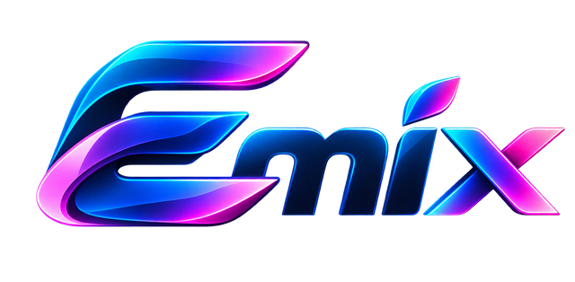
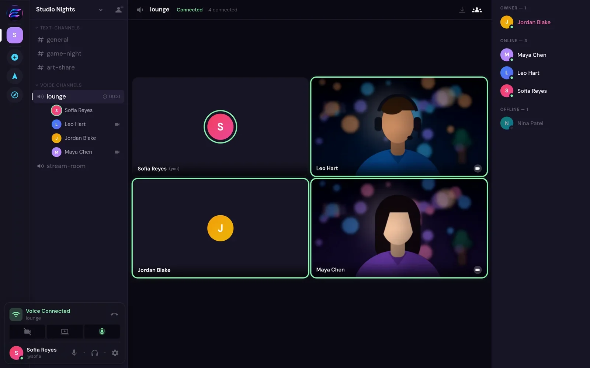
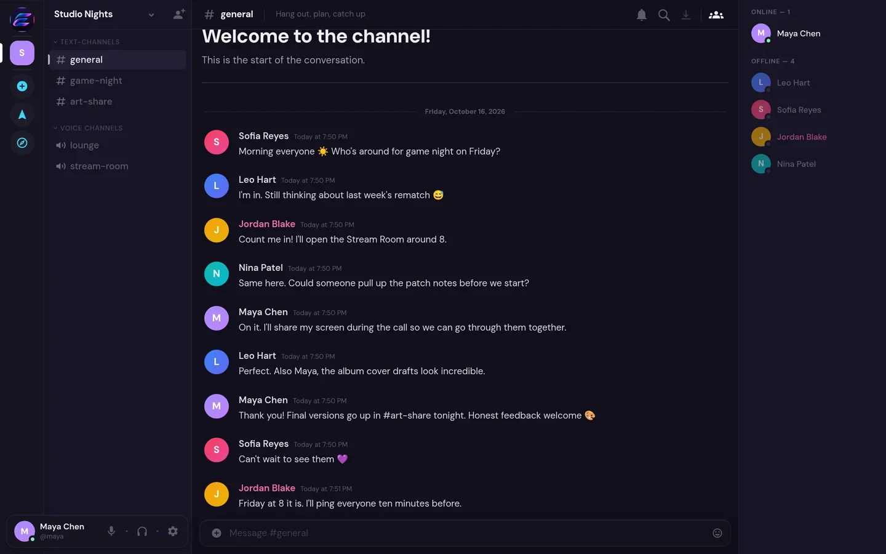
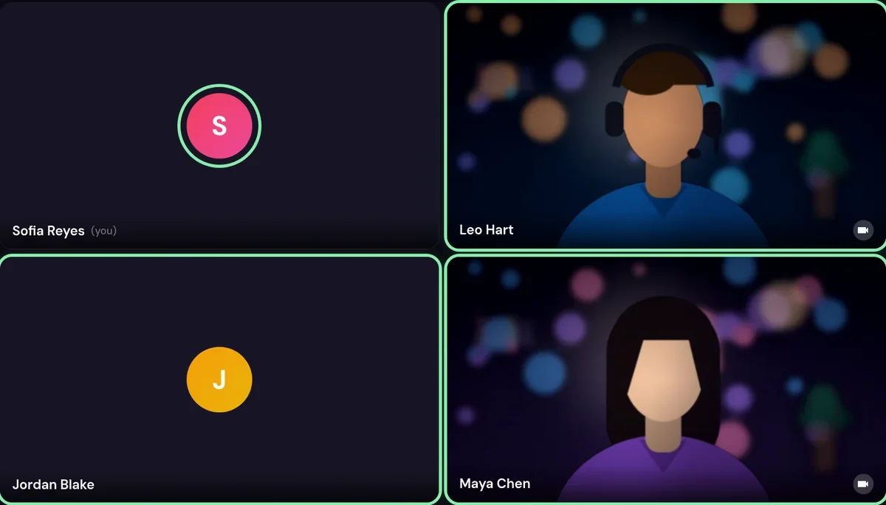
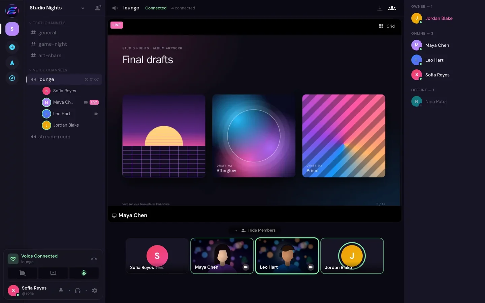
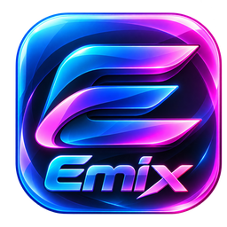

### Emix | Connect Without Compromise

Private messaging, high-quality voice and video calls, and screen sharing in one app. 
No subscriptions, no premium tiers, no locked features.

 

&nbsp;

&nbsp;

 

 

## Why Emix

<table>
  <tr>
    <td width="33%" valign="top">
      <h3>🔒 Privacy First</h3>
      Communication without unnecessary tracking or advertising. No ads, no analytics, no usage statistics, and invite-only sign-up.
    </td>
    <td width="33%" valign="top">
      <h3>🎥 High-Quality Video</h3>
      Video calls at 720p, 1080p, 1440p or 4K, at 30 or 60 fps. You choose the quality; your camera, computer and connection set the limit.
    </td>
    <td width="33%" valign="top">
      <h3>🎙️ Crystal-Clear Voice</h3>
      Real-time voice over WebRTC with noise suppression and echo cancellation. Use push-to-talk or voice activity.
    </td>
  </tr>
  <tr>
    <td width="33%" valign="top">
      <h3>🖥️ High-Quality Screen Sharing</h3>
      Share a window, an app or your whole screen. Presets for sharp text or smooth motion, up to 4K or native resolution at 60 fps.
    </td>
    <td width="33%" valign="top">
      <h3>💜 No Paywalls</h3>
      No subscriptions, premium tiers or paid feature unlocks. Everyone gets the same Emix with the same features.
    </td>
    <td width="33%" valign="top">
      <h3>💬 Messaging and Communities</h3>
      Direct messages, group chats and spaces with text and voice channels, roles and permissions. Replies, reactions, file sharing and search.
    </td>
  </tr>
</table>

## A closer look

<table>
  <tr>
    <td width="50%" valign="top">
      
      
<b>Messaging</b> Spaces, channels and conversations, kept organized.

    </td>
    <td width="50%" valign="top">
      
      
<b>Video calls</b> Choose your resolution and frame rate. Each viewer receives the quality their screen and connection can handle.

    </td>
  </tr>
  <tr>
    <td colspan="2" valign="top">
      
      
<b>Screen sharing</b> Present, review or play together, with cameras on alongside the stream.

    </td>
  </tr>
</table>

Screenshots show the Emix app with demonstration accounts. Camera images are illustrations.

## Download and install

### Windows (10 and 11, 64-bit)

1. Download the installer from **[getemix.com/download/windows](https://getemix.com/download/windows)**, or pick a file from the [latest release](https://github.com/hazyrealm/emix/releases/latest):
   - `Emix-<version>-win-x64.exe` for most PCs
   - `Emix-<version>-win-arm64.exe` for Windows on ARM
2. Run the installer. The installer is not yet code-signed, so Windows SmartScreen may show a warning the first time. Choose **More info**, then **Run anyway**.
3. Sign in with your Emix account. Emix updates itself automatically when a new version is released.

### In your browser

Open **[app.getemix.com](https://app.getemix.com)** in any modern browser. Nothing to install.

> Emix is invite-only. To create an account you need an invitation from an Emix administrator.

## Privacy

- **No ads and no tracking.** Emix shows no advertising, and the Emix service sends no usage statistics or telemetry anywhere.
- **Encrypted in transit.** The app connects over HTTPS (TLS). Calls and screen shares use WebRTC, which encrypts media with DTLS-SRTP.
- **Not end-to-end encrypted.** The Emix server can technically access the messages and media it relays. We do not claim otherwise.

## Built with

TypeScript throughout: a React web app (Vite), a Fastify server with SQLite, [LiveKit](https://livekit.io) for real-time voice, video and screen sharing, and an Electron desktop app for Windows.

Operators can find deployment and operations documentation in [`deploy/README.md`](deploy/README.md).

## Reporting a security issue

Please do not open a public issue. Report vulnerabilities privately through [GitHub security advisories](https://github.com/hazyrealm/emix/security/advisories/new). See [SECURITY.md](SECURITY.md).

## License

Emix is free and open-source software licensed under the **GNU Affero General Public License v3.0** ([LICENSE](LICENSE)). The complete source code of the Emix service and apps is in this repository.

Emix is a modified version of [Backspace](https://github.com/TheZwiss/backspace), Copyright © 2026 Jannis Braun, licensed under AGPL-3.0. Emix's changes are described in [EMIX.md](EMIX.md), and third-party notices are in [NOTICE](NOTICE). Legal information is also at [getemix.com/legal](https://getemix.com/legal/).

 

  
   
  <a href="https://getemix.com">getemix.com</a> · <a href="https://app.getemix.com">Open Emix</a> · <a href="https://getemix.com/download/windows">Download for Windows</a>

